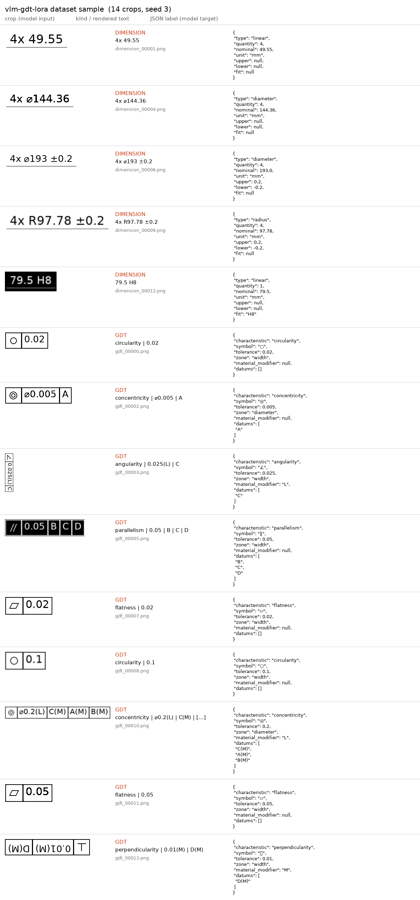

# vlm-gdt-lora

Can a 3B vision-language model learn to read engineering-drawing callouts as
strict JSON after a few minutes of QLoRA on a free Colab T4?

Two crop types, both with exact labels because the image and the label come
from the same random draw:

| kind | example crop | target JSON keys |
|---|---|---|
| `dimension` | `4x R205.38 ±0.02`, `⌀199 H7` | type, quantity, nominal, unit, upper, lower, fit |
| `gdt` (feature control frame) | `◎ │ ⌀0.01(L) │ C(M) │ A(M)` | characteristic, symbol, tolerance, zone, material_modifier, datums |

Crops are degraded at random (blur, 90/180/270° rotation, binarise, invert) so
the task is not pure clean-text OCR.

## What the data looks like

`samples/contact_sheet.png` shows 14 crops next to their JSON labels, and
`samples/gdt_symbols_legend.png` shows all 14 GD&T characteristic symbols as
the generator draws them. Regenerate with `python tools/make_samples.py`.



The 14 GD&T symbols are drawn as line geometry (`draw_symbol` in
`gen_crops.py`), not typed from a font: no free font covers all of them
(DejaVu Sans is missing 8, Noto Sans Math 4), and the original generator
silently rendered those as tofu boxes. Text cells use the vendored
`assets/DejaVuSans.ttf`, which has `⌀` and `±`.

## Pipeline

```
gen_crops.py ──▶ out/{train,test}.jsonl + out/images/   (600 unique crops, 83/17 split)
      │
      ▼
notebooks/qwen_vl_lora.ipynb  (Colab T4)
      1. Qwen2.5-VL-3B-Instruct in 4-bit (Unsloth)
      2. zero-shot on test  ──▶ preds_zeroshot.jsonl ──▶ eval_crops.py   ← "before"
      3. QLoRA r=16 (4-bit base, adapters on language layers), 1 epoch SFT
      4. fine-tuned on test ──▶ preds_lora.jsonl     ──▶ eval_crops.py   ← "after"
      5. save adapter lora_gdt_crops/
```

`eval_crops.py` reports JSON-valid rate, exact match, field-level
precision / recall / F1 and hallucination rate (= 1 − precision), per kind.

## Run it

1. In Colab: File → Upload notebook → `notebooks/qwen_vl_lora.ipynb`. The
   notebook is self-contained (it writes `gen_crops.py` and `eval_crops.py`
   itself), so no clone or upload of anything else is needed.
2. Runtime → Change runtime type → T4 GPU, then run top to bottom. Data is
   generated on Colab (DejaVu font has the GD&T glyphs; macOS does not ship it).
3. Paste the two `eval_crops.py` tables into the Results section below.
4. Download `lora_gdt_crops/` to Drive before the VM is recycled.

Ablation worth one extra run: cell 5 with `finetune_vision_layers=True` —
does the gain come from the LLM learning the output format, or from the
vision encoder learning the glyphs?

## Results

Run 1 (2026-11-07, Colab T4, data from the pre-vector-symbol generator, so
8 of 14 GD&T symbols were tofu boxes in both train and test):

| model | kind | n | json_ok | exact | prec | rec | f1 | halluc |
|---|---|---|---|---|---|---|---|---|
| zero-shot | all | 102 | 0.99 | 0.00 | 0.22 | 0.20 | 0.21 | 0.78 |
| zero-shot | dimension | 57 | 1.00 | 0.00 | 0.34 | 0.33 | 0.33 | 0.66 |
| zero-shot | gdt | 45 | 0.98 | 0.00 | 0.05 | 0.04 | 0.05 | 0.95 |
| **QLoRA (lang layers)** | **all** | 102 | 1.00 | **0.29** | 0.74 | 0.74 | **0.74** | **0.26** |
| QLoRA (lang layers) | dimension | 57 | 1.00 | 0.53 | 0.85 | 0.85 | 0.85 | 0.15 |
| QLoRA (lang layers) | gdt | 45 | 1.00 | **0.00** | 0.60 | 0.58 | 0.59 | 0.40 |

Before → after, same 102 crops, only the 0.79% LoRA block changed:
field F1 **0.21 → 0.74**, hallucination **0.78 → 0.26**, exact **0 → 29**
crops. Dimensions are mostly solved (85% of fields, half the crops perfect).
GD&T moved from 0.05 to 0.59 F1 but **not one GD&T crop is fully correct**:
with 8 of 14 symbols rendered as identical tofu boxes, `characteristic` and
`symbol` are unreadable from pixels, so every frame loses at least those two
fields. That is the motivation for drawing the symbols as geometry (now in
`gen_crops.py`); run 2 should move `gdt exact` off zero.

Training (run 1): 498 examples, 1 epoch, 63 steps, total batch 8,
**29.9M trainable of 3.78B parameters (0.79%)**, 5 min on a T4.

| step | 5 | 10 | 15 | 20 | 25 | 30 | 35 | 40 | 45 | 50 | 55 | 60 |
|---|---|---|---|---|---|---|---|---|---|---|---|---|
| loss | 4.56 | 2.36 | 0.81 | 0.20 | 0.10 | 0.10 | 0.05 | 0.05 | 0.06 | 0.05 | 0.05 | 0.04 |

Reading the zero-shot row: the base model already emits valid JSON 99% of
the time, so format is not the problem; it gets 0 of 102 crops fully right
and only a third of dimension fields, and 78% of the fields it writes are
not in the label. GD&T is near zero: it does not know the schema's vocabulary
(`circular_runout`, `zone: width`, `C(M)`) and half the symbols were boxes.

## Local dev

```bash
uv venv && uv pip install pillow pytest
.venv/bin/python -m pytest        # checks the generator: unique crops, no train/test overlap
```

`colab_qwen_vl_lora.py` is the source of truth for the notebook (each `# %%`
is a cell); regenerate the `.ipynb` with `tools/build_notebook.py` after
editing it. The Unsloth vision API (`FastVisionModel`,
`UnslothVisionDataCollator`) follows Unsloth's public notebooks as of 2025–26 —
if a call errors, check https://unsloth.ai/docs for the current signature.
